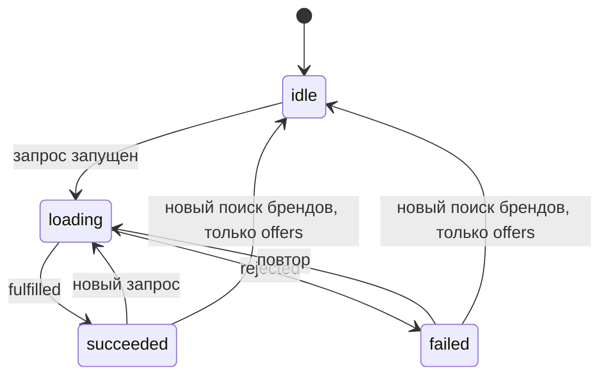
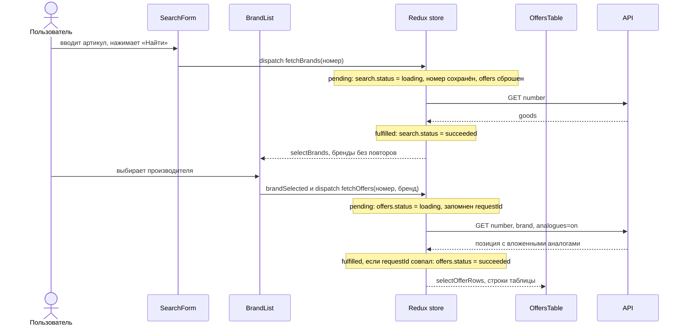

# Архитектура

Как устроено приложение: структура, состояние Redux, поток данных двух этапов и принятые решения. Запуск и правила показа цены описаны в [README](README.md).

## Структура

```
src/
  api/partsApi.js            запрос к сервису, разбор ответа, ApiError
  features/search/           этап 1
    searchSlice.js             состояние, thunk fetchBrands, селекторы
    SearchForm.jsx             поле артикула и кнопка
    SearchStatus.jsx           загрузка, ошибка, «ничего не найдено»
    BrandList.jsx              список производителей, запускает этап 2
  features/offers/           этап 2
    offersSlice.js             состояние, thunk fetchOffers, селекторы
    offerRules.js              чистые функции: цена, остаток, склады, порядок строк
    OffersTable.jsx            загрузка, ошибка, пусто или таблица
  components/Loader.jsx      индикатор загрузки
  store.js                   makeStore() для тестов и store для приложения
```

Слои идут сверху вниз: компоненты читают состояние через селекторы и запускают thunk, thunk вызывают `partsApi`, API-слой ничего не знает о Redux и React.

## Состояние Redux

Два независимых slice: на втором этапе есть свой процесс загрузки, и пока таблица грузится, список производителей остаётся готовым. Один общий `status` так выразить нельзя.

**`state.search`** (этап 1)

| Поле | Что хранит |
|---|---|
| `status` | `idle` / `loading` / `succeeded` / `failed` |
| `number` | номер, с которым искали (пишется в `pending`, остаётся после ошибки) |
| `goods` | позиции из ответа |
| `error` | текст ошибки (строка, не объект `ApiError`: в state кладём сериализуемое) |
| `selectedBrand` | выбранный производитель |

**`state.offers`** (этап 2)

| Поле | Что хранит |
|---|---|
| `status` | `idle` / `loading` / `succeeded` / `failed` |
| `brand` | производитель, для которого грузится или показана таблица |
| `requestId` | id последнего запущенного запроса (защита от устаревших ответов) |
| `goods` | главная позиция и вложенные аналоги |
| `error` | текст ошибки |

Данные для экрана выбираются селекторами, а не считаются в компонентах: `selectBrands` (производители без повторов, в порядке ответа) и `selectOfferRows` (плоский список позиций и аналогов с ценой и остатком, отсортированный). Оба сделаны через `createSelector`: пока исходные данные те же, возвращается тот же массив, и компонент не перерисовывается впустую.

### Статусы

Один и тот же жизненный цикл у обоих thunk:



«Ничего не найдено» это `succeeded` с пустым списком, а не ошибка. Поэтому сообщение показывается только в `succeeded`: в `idle` список тоже пуст, но искать ещё не начинали.

## Поток данных



## Принятые решения

1. **Два slice.** Два независимых процесса загрузки не помещаются в один `status`. Связь между ними односторонняя: `offers` слушает `fetchBrands.pending` из `search` и сбрасывается, чтобы под новым списком производителей не осталась таблица от старого поиска.
2. **Номер второго этапа берётся из store.** Текст в поле ввода это локальное состояние формы и может уже отличаться от того, по чему получен список. В store лежит номер, с которым реально искали. Запрос второго этапа идёт по нему, а не по `number` позиции: у некоторых производителей номер записан иначе (например `H01089-00`).
3. **Слой API не принимает решений о показе.** Позиции без остатка не отбрасываются: интерфейс показывает их как «нет в наличии». Фильтровать нужно только «пустую» позицию, которой сервис отвечает на «ничего не найдено».
4. **Правила цены и порядка в чистых функциях** (`offerRules.js`), отдельно от Redux и компонентов. Их проверяют обычными тестами «данные на входе, результат на выходе». Цена `null` («неизвестно») отличается от `0`: ноль показал бы «бесплатно» и поставил бы позицию первой в сортировке. Список складов позиции строится там же (`getWarehouses`): склады с остатком по возрастанию цены; дата отгрузки берётся из строки, а не через `Date`, чтобы часовой пояс не сдвигал день; ключ склада `id`, потому что `code` у складов повторяется.
5. **Гонка запросов.** Каждый запуск thunk получает свой `requestId`. Slice хранит id последнего запроса и игнорирует ответы с другим id. Так запоздалый ответ прежнего производителя не затирает таблицу нового, а ответ, пришедший после нового поиска, не воскрешает старую таблицу. Сам запрос в сети не отменяется.
6. **Повторный выбор того же производителя** не перезапрашивает таблицу (`condition` у `fetchOffers`): запрос уже летит или данные уже есть. После ошибки повтор разрешён, иначе ошибка стала бы тупиком.
7. **Ошибки.** Все сбои (сеть, статус, поле `error`, нечитаемый ответ, таймаут) превращаются в `ApiError` с русским сообщением. В state попадает только строка сообщения. Таймаут запроса 15 секунд (`AbortSignal.timeout`): сигнал создаётся заново на каждый вызов, потому что сработавший сигнал сбросить нельзя, а один общий сигнал на модуль «сгорел» бы через 15 секунд после открытия страницы.
8. **Тесты на уровне сети.** Запросы подменяются MSW, параметры (`number`, `brand`, `analogues`) проверяются в обработчике. Для изоляции каждый тест создаёт свой store через `makeStore()`.
