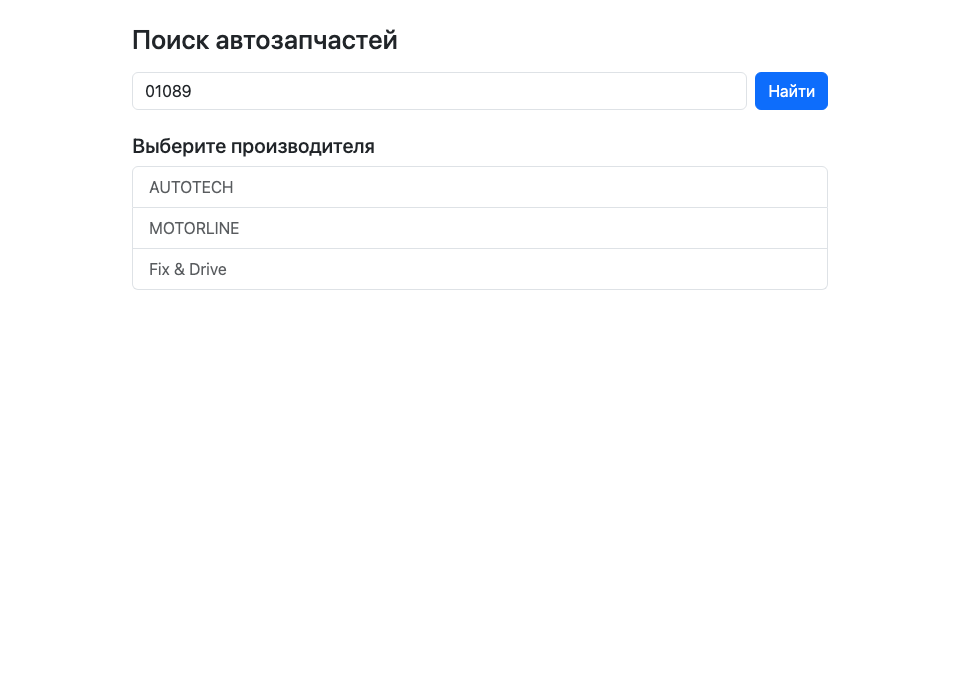
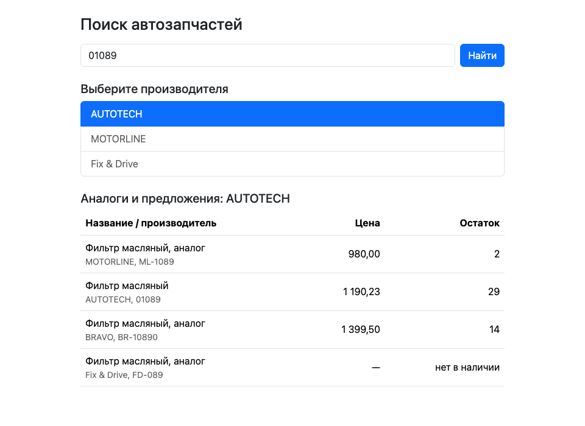

# Parts Search Client

Тестовое задание на React: поиск автозапчастей по артикулу в два этапа.

1. Вводишь артикул и получаешь список производителей, у которых есть такая деталь.
2. Выбираешь производителя и получаешь таблицу аналогов и предложений: название и производитель, цена, остаток на складе.

Приложение показывает загрузку, ошибки сервиса, сбой сети и пустой результат. Данные берутся из внешнего API поиска запчастей.

## Как выглядит

Первый этап: список производителей по введённому артикулу.



Второй этап: аналоги и предложения выбранного производителя, у позиции раскрыт список складов.



Скриншоты сняты на демонстрационных данных: ответы API подменены, реальные данные поставщика на них не показаны.

## Стек

- React 19 и Redux Toolkit (`createSlice`, `createAsyncThunk`, `createSelector`), только JavaScript, без TypeScript
- Bootstrap 5 (подключён только CSS)
- Vite, oxlint, Prettier
- Vitest, Testing Library, MSW (сеть в тестах подменяется на уровне запросов)

## Запуск

Нужен Node 24 (версия в `.nvmrc`).

```bash
npm install
cp .env.example .env    # впиши адрес и ключ API
npm run dev
```

В `.env` две переменные:

| Переменная | Что это |
|---|---|
| `VITE_API_URL` | адрес сервиса поиска (в `.env.example` стоит заглушка) |
| `VITE_API_KEY` | ключ доступа к API |

Остальные команды:

| Команда | Что делает |
|---|---|
| `npm test` | прогон тестов |
| `npm run lint` | проверка oxlint |
| `npm run format` | форматирование Prettier |
| `npm run build` | production-сборка |

## Как это устроено

```
src/
  api/partsApi.js       запрос к сервису, разбор ответа, ошибки (ApiError)
  features/search/      этап 1: форма, статус, список производителей, slice
  features/offers/      этап 2: таблица, slice, правила цены и остатка
  components/Loader.jsx индикатор загрузки
  store.js              сборка Redux store
```

Подробно: поток данных, состояние и принятые решения описаны в [ARCHITECTURE.md](ARCHITECTURE.md).

Состояние делится на два независимых slice: `search` (артикул, позиции, выбранный производитель) и `offers` (таблица второго этапа). У каждого свой статус `idle` / `loading` / `succeeded` / `failed`: пока таблица грузится, список производителей остаётся на экране. Новый поиск сбрасывает таблицу.

## Как показываются цена и остаток

В ответе у позиции есть общая цена, но она не используется: цена берётся со складов.

| Что | Правило |
|---|---|
| Цена | минимальная среди складов, где есть остаток и цена больше нуля; иначе «—» |
| Остаток | общее количество на всех складах |
| Склады | в строке позиции раскрывается список «Склады (N)»: склады с остатком по возрастанию цены, у каждого цена, остаток и дата отгрузки |
| Нет в наличии | позиция остаётся в таблице, остаток подписан «нет в наличии», строка приглушена, списка складов нет |
| Порядок | сначала в наличии по возрастанию цены, затем «нет в наличии»; при равенстве по производителю и номеру |

Валюта в документации API не указана, поэтому цена показывается числом без знака.

## Особенности сервиса и как они учтены

- **Спецсимволы в названии.** Производитель `Meat & Doria` передаётся через `URLSearchParams`, иначе `&` ломает запрос.
- **Номер на втором этапе.** Номер у позиции может отличаться от введённого (например `H01089-00` вместо `01089`), поэтому запрос второго этапа идёт по введённому номеру.
- **«Ничего не найдено».** Сервис отвечает массивом с одной пустой позицией; она отфильтровывается, пользователь видит понятное сообщение.
- **Ошибки.** Сервис пишет их в поле `error`, иногда вместе с HTTP 403. Текст ошибки читается из тела до проверки статуса, сбой сети и нечитаемый ответ тоже превращаются в понятное сообщение.
- **Нестабильный порядок.** Сервис возвращает позиции и склады в произвольном порядке, поэтому сортировка делается на клиенте.
- **Гонка запросов.** Если быстро выбрать двух производителей, ответ прежнего запроса игнорируется (по `requestId`) и не затирает актуальную таблицу.
- **Повторный выбор.** Клик по уже выбранному производителю не перезапрашивает таблицу; после ошибки повторить можно.

## Тесты

Тесты проверяют слой API (форма запроса, разбор ответов, ошибки), состояние Redux (статусы, сброс, устаревшие ответы), правила цены и порядка строк, а также компоненты на сценариях «как пользователь» по двум этапам. Запросы подменяются MSW, настоящий сервис не вызывается.

## Ограничения

- API доступен только по HTTP: развёрнутая на HTTPS страница не сможет к нему обратиться (mixed content), поэтому проект рассчитан на локальный запуск.
- Ключ из `.env` попадает в клиентскую сборку и виден в браузере. Для клиентского приложения без собственного бэкенда это допустимо, в реальном проекте запросы шли бы через сервер.
- Устаревшие запросы не отменяются в сети, их ответы просто игнорируются.
